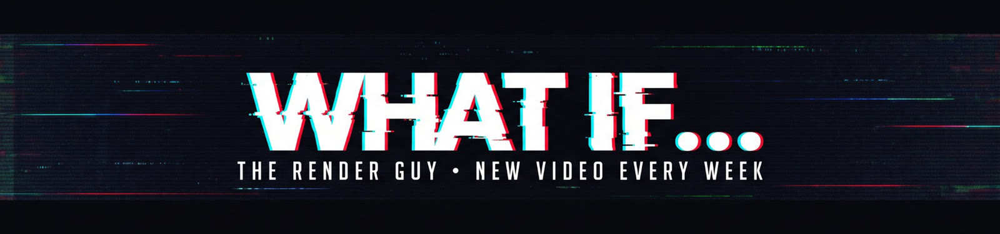

  

<h2 align="center">Hi, I'm Jakub 👋</h2>

  I run <b>The Render Guy</b> on YouTube, where I ask "what if?" and make AI build things it probably shouldn't be able to: 
  operating systems from scratch, a phone OS, a TV OS, motion graphics in After Effects, and documentaries.

  
  
  

---

## ✦ Featured project

**[Lumen OS 2](https://github.com/dosty340-max/lumen-os-2)**: a phone operating system written from scratch by Claude. It has its own compositor, the "Slab" design, its own DHCP/DNS/HTTP stack, an HTML/CSS browser, and a YouTube player. It runs in QEMU on Apple Silicon. 8,227 lines of C, 32/32 end-to-end tests passing.

## ✦ Videos

<table>
<tr>
<td align="center" width="33%">
   
  <b>I Forced AI to Build a Phone OS From Scratch</b>
</td>
<td align="center" width="33%">
   
  <b>What If the Internet Went Down for 24 Hours?</b>
</td>
<td align="center" width="33%">
   
  <b>I Let AI Build a TV OS While I Slept</b>
</td>
</tr>
<tr>
<td align="center">
   
  <b>How I Forced AI to Build a Universal Operating System?!</b>
</td>
<td align="center">
   
  <b>I Forced AI to Build a Custom Operating System</b>
</td>
<td align="center">
   
  New video every week
</td>
</tr>
</table>

## ✦ How I make them

  
  
  
  
  
  
  
  
  

The AI writes the code and I'm not allowed to touch it. Then I boot it, test it on camera, and try to break it.

💬 Got an idea for what the AI should build next? Leave it in the comments on the latest video.

